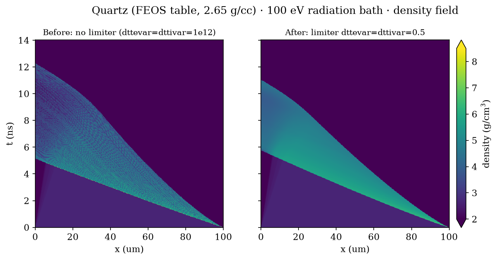
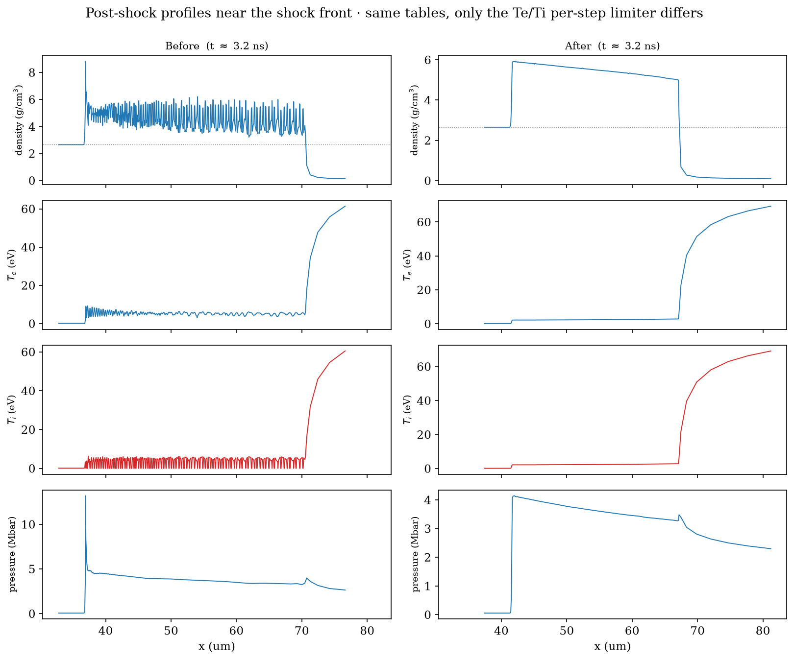
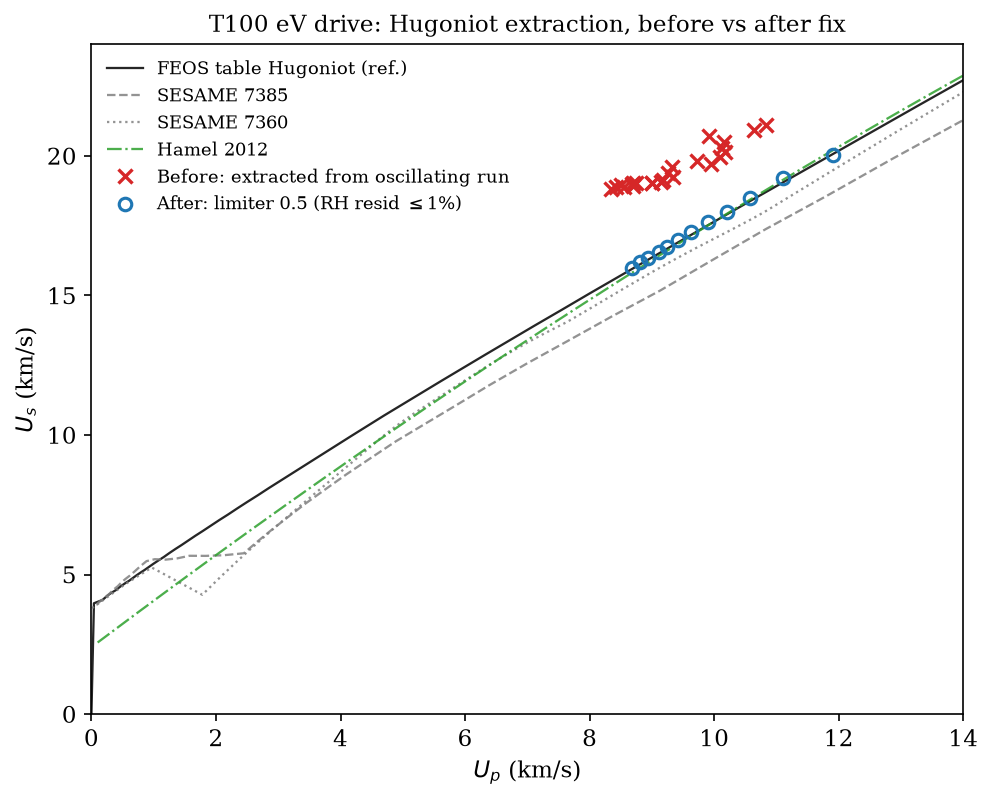
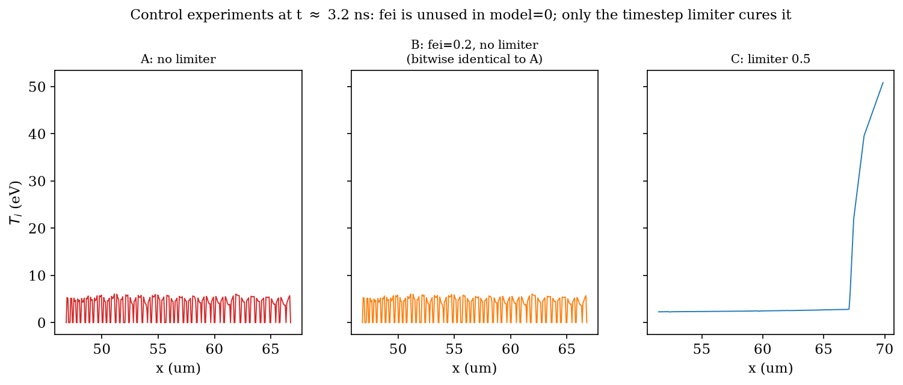
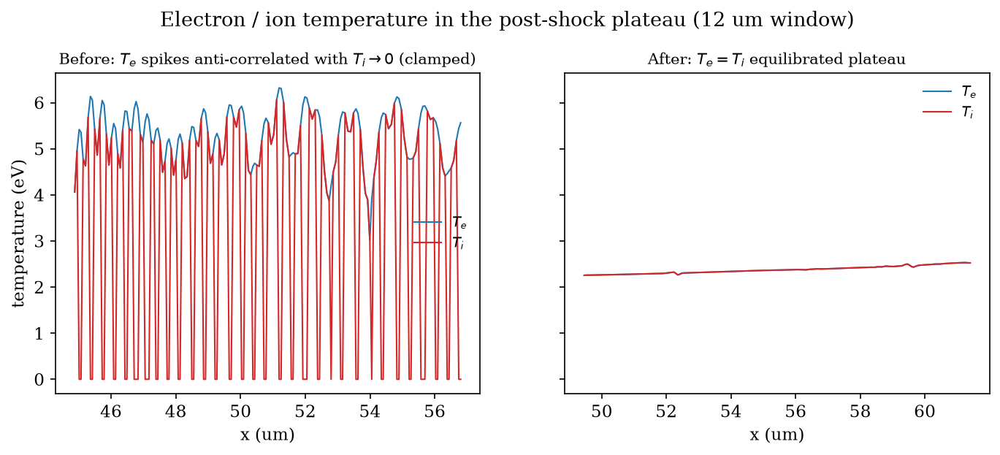

# 辐射流体算例波后密度网格尺度振荡：问题、诊断与解决全过程

> **案例**：MULTI-IFE-2015 一维双温辐射流体程序（m150304.f95）· FEOS 计算的 α-石英（2.65 g/cc）双温 EOS 表 · 100 eV 恒辐射浴驱动
> **时间线**：2026-08-13 晚发现 → 08-14 两次误判 → 用户要求消除 → 当天定位根因并修复
> **一句话结论**：波后密度网格尺度振荡是**电子-离子能量交换的时间步欠解析（sloshing）**，不是 EOS 表质量问题；在时间步控制里给 Te/Ti 每步相对变化加限幅（`dttevar=dttivar=0.5`）即除。
> **适用范围**：任何双温（Te/Ti 分离）拉氏辐射流体代码遇到"波后网格尺度持续振荡"都可参照本文的诊断路径。

---

## 目录

1. [一分钟速览（如果你很急）](#1-一分钟速览如果你很急)
2. [背景：算例与代码设定](#2-背景算例与代码设定)
3. [症状：看到了什么](#3-症状看到了什么)
4. [弯路：两次误判](#4-弯路两次误判)
5. [诊断：如何锁定真凶](#5-诊断如何锁定真凶)
6. [机理：这个过程是物理的还是非物理的](#6-机理这个过程是物理的还是非物理的)
7. [修复：两行配置 + 验证](#7-修复两行配置--验证)
8. [代价与参数选择策略](#8-代价与参数选择策略)
9. [给你的 Checklist（遇到同类问题照此办理）](#9-给你的-checklist遇到同类问题照此办理)
10. [附录：文件、命令与复现说明](#10-附录文件命令与复现说明)

---

## 1. 一分钟速览（如果你很急）

**症状**：冲击波后密度/压力出现**网格尺度的持续锯齿振荡**（相邻单元 ±25%，不衰减），只在特定驱动强度（辐射浴 ≥100 eV，波后 P≳4 Mbar）出现；弱驱动和另一套 EOS 表完全干净。

**判据（一眼实锤）**：读振荡时刻波后逐单元温度——**离子温度 Ti 精确等于 0.00 eV（被钳制的负值），而电子温度 Te 高达 7–9 eV**，逐格交替。任何热平衡时间尺度合理的物理体系都不会出现这种状态。

**修复**：时间步控制里限制每步 Te/Ti 相对变化：

```diff
&parameters
-   dttevar     = 1e12,     ! = 不设限（祸根）
-   dttivar     = 1e12,
+   dttevar     = 0.5,      ! 每步 Te 相对变化 ≤50%
+   dttivar     = 0.5,      ! 每步 Ti 相对变化 ≤50%
```

效果立竿见影：Ti 不再归零、Te=Ti 平衡、密度平台平滑，Hugoniot 提取点全部回到理论线上（RH 残差 ≤1%）。

---

## 2. 背景：算例与代码设定

### 2.1 算例：Hugoniot 二轮校验

EOS 表入库前用冲击压缩实验数据校验：厚板（1 mm）+ 恒温辐射浴从右侧入射，驱动一个准定常激波向左传播；追踪波前轨迹得 Us，取波后平台态得 Up/P/ρ，画 **Us-Up 图**与文献理论线（SESAME、FEOS 官方 Hugoniot 等）对比。四档驱动强度 trad = 50/75/100/150 eV。

### 2.2 代码：一维双温拉氏辐射流体

- 电子/离子**双温**（Te、Ti 独立演化），能量方程含电子-离子交换项 `transf = kei·(Te−Ti)`；
- 拉氏网格（本算例 800 单元），激波靠人工粘性钝化；
- 时间步由多变量变化率控制（这是本案的关键机关，见 §5.3）。

### 2.3 EOS 表：两套石英对照

| 表 | 来源 | 表现 |
|---|---|---|
| Multi_BACK 迁移表 | 随程序发布的成品表 | 同驱动强度下**干净** |
| FEOS 计算表 | 第一性原理模型新生成、转换入库 | **T100 档振荡** |

同代码、同网格、同驱动，**只有表不同**——这正是最初误导我们把矛头指向表的原因。

---

## 3. 症状：看到了什么

### 3.1 密度场整体形貌



左（改前）：激波后面拖着一条**毛刺带**——密度在网格尺度上锯齿振荡，从波后一直延伸到烧蚀区，**不随时间衰减**。右（改后，仅改了时间步限幅）：波后是干净的压缩平台。

### 3.2 逐单元剖面（t≈3.2 ns，激波前沿附近）



改前（左列）四个物理量全是病象：

- **密度**：平台本应平滑在 ~5.9 g/cc，实际相邻单元在 4.3–6.1 之间跳；
- **Te**：波后本应平衡在 ~2 eV，实际尖到 7–9 eV；
- **Ti**：大面积单元**精确归零**；
- **压力**：跟随密度/温度逐格锯齿。

改后（右列）全部恢复物理形态。

### 3.3 触发条件的"特定"

这个振荡**不是随时出现**，而是有明确的驱动强度窗口：

- T50/T75（波后 P≲2 Mbar）：两套表都干净；
- **T100（P≈4–5 Mbar）：FEOS 表振荡**，Multi_BACK 表仍干净；
- T150（P≈10–20 Mbar）：细网格重转后也干净。

即：**特定 EOS 表 × 特定驱动强度**的组合才触发。这种条件依赖性是诊断的重要线索——它说明这不是随机的程序 bug，而是某个物理量（后面知道是交换时间尺度 τ_ei = Cv/kei）在该状态区恰好越过临界值。

### 3.4 危害：不只是"难看"

波后平台取样落在压力尖峰上，提取的 Hugoniot 点被系统性污染：



红叉（改前提取）：散乱且**系统性高于理论线 ~8–15%**，RH 动量残差在 −9% 到 +13% 之间。蓝圈（改后提取）：紧贴 FEOS/SESAME 理论线，12/12 点残差 ≤1%。**如果不去除振荡，这套表的强冲击校验会得出"表偏硬 15%"的错误结论。**

---

## 4. 弯路：两次误判

记录误判不是丢脸的事——它标出了这类问题的诊断陷阱，你的朋友大概率会先掉进同一个坑。

**误判一："EOS 表插值导数噪声"**（08-13 晚）

振荡只在 FEOS 表出现 → 自然怀疑是转换器用 PCHIP 反演生成的表导数不光滑 → 用更细网格重新转表重跑 → **同样振荡**。排除。

**误判二："TF EOS 导数结构与拉氏格式相互作用"**（08-14 上午）

细网格排除插值问题后，归因为"FEOS Thomas-Fermi EOS（含 Maxwell 构造段）的导数结构在该压强区与流体格式相互作用，非转换器问题"——这已经接近真相（确实与表的 Cv 结构有关），但当时止步于"使用受限"的保守结论，没有找到消除办法。

**两次弯路的共同错误：只盯着 EOS 表侧找毛病，没有去看解本身——振荡单元里的 Te/Ti 到底是什么状态。** 转折点是用户一句"振荡非常奇怪，有没有办法消除"，促使我们回到 fort.10 输出本身，一步就看到了真凶。

---

## 5. 诊断：如何锁定真凶

### 5.1 Step 1：读振荡单元的物理量（决定性一步）

解析 fort.10 的 ASCII 记录，打印 t≈3.2 ns 波后逐单元 ρ/Te/Ti/P：

```python
import numpy as np
d = read_fort10_ascii('fort.10')          # -> dict: TIME(n,1), R/TE/TI/PT/XC(n,800)
k = np.argmin(np.abs(np.array(d['TIME'])[:,0] - 3.2e-9))
rho, te, ti = np.array(d['R'])[k], np.array(d['TE'])[k], np.array(d['TI'])[k]
i = np.where(rho > 2.65*1.05)[0]          # 压缩区
print(f"Ti≈0 的单元数: {(ti[i] < 0.005).sum()} / {len(i)}")
```

输出（改前）：**463 个压缩单元中 171 个 Ti < 0.005 eV（37%），同时这些单元 Te 高达 7–9 eV**。

### 5.2 Step 2：排除表侧假说（要排除得干净）

对表做了两项独立体检，都有"问题"，但都被位置排除：

| 体检项 | 发现 | 为什么不是它 |
|---|---|---|
| P(ρ) 定能单调性 | 大量非单调点（个别能层 40 个） | 打印坏点 ρ 坐标：**全在 ρ<0.06 g/cc 的汽/膨胀区**，冲击区 ρ∈[3,12] 干净 |
| 能量网格重复点 | 电子表 512 点中 37 处重复/非增 | 同样集中在极低能区，冲击波后态（数 eV）够不到 |

**方法论：发现"表有问题"后，必须核对问题点是否在算例实际访问的状态区内。** 好的坏消息是这两项体检顺带证明了表在冲击区是干净的，把嫌疑彻底从表侧移开。

### 5.3 Step 3：查源码时间步控制，找到现成的开关

grep 时间步控制逻辑，定位到 m150304.f95 第 549 行：

```fortran
var=max(var, varr/p%dtrvar, varte/p%dttevar, varti/p%dttivar)
```

含义：每步计算 ρ/Te/Ti 的相对变化（varr/varte/varti），除以各自的**允许值**取最大者去控制下一步 dt。算例模板里 `dttevar=dttivar=1e12` ——分母是天文数字，等于**这两项限幅根本不存在**。

于是链路闭合：

```
FEOS 表 Cv 结构（物理真实） → 该状态区 τ_ei = Cv/kei 极短（刚性）
→ dt(≈1e-11 s) ≫ τ_ei → 交换项数值过冲 → Ti 被打负、钳到 0
→ 相邻单元压力锯齿 → 密度持续振铃
```

### 5.4 对照实验闭环（可选但推荐）

为验证"是时间步问题、不是交换率问题"，设计了三变体对照（同表、同驱动、只改配置）：



- **A** 无限幅：振荡（基线复现）；
- **B** 交换率系数 fei 降到 0.2 + 无限幅：与 A **逐位相同**——后查源码发现本算例 `model=0`（经典等离子体）路径下 fei 根本不进入耦合系数（`collfreq` 的 `case(0)` 分支不使用该乘子），是个空开关；
- **C** 限幅 0.5：干净。

B 的教训值得单独强调：**调参数做对照实验前，先确认这个参数真的被代码用了**。我们的 B 实验最初被解读为"降交换率治不了 sloshing"，真实情况是这个旋钮压根没接上线。

---

## 6. 机理：这个过程是物理的还是非物理的

**结论：振荡本身是非物理的数值假象；但触发它的病根（交换弛豫的刚性）是真实物理。**

**为什么振荡不可能是物理过程：**

1. **物理 e-i 弛豫没有振荡机制。** 交换项 d(Te−Ti)/dt = −(Te−Ti)/τ 是纯耗散弛豫，τ>0 时温差单调指数衰减到零，不存在惯性或恢复力项——真实的 Te/Ti 不会互相"荡秋千"。
2. **观测状态热力学上不成立。** Ti=0.00 eV（程序对负值的钳制值，本身就是过冲的证据）与 Te=7–9 eV 并存，且逐格交替、锁定网格尺度。物理不稳定性（RT/RM 等）有自己的物理波长和增长率；**严格逐格交替是数值不稳定性的签名**。
3. **收敛 + 独立验证。** 限幅让 dt 解析交换时标后振荡彻底消失，解收敛到平滑的 Te=Ti 平衡态，且通过独立检验：RH 动量/能量残差 ≤1%、提取点贴上独立计算的 FEOS 官方 Hugoniot 线（Us≤1.3%）和 SESAME 散布带。

**真实的物理部分：**

交换物理本身是真的（Landau-Spitzer 型碰撞耦合），FEOS 表在该 (ρ,T) 区 Cv 结构造成的**短交换时标也是表的真实属性**——Multi_BACK 表同驱动干净，是因为它的 Cv 结构温和、τ_ei 更长，同样的 dt 不越界。数值侧的失败点：交换项以旧态线性化的半隐式格式积分，系数含 1/Cv（表差分斜率的倒数），FEOS 表平坦的 T(e) 段使线性化在刚性区失真，dt 又远大于 τ_ei，一步过冲。

一句话：**物理提供了刚性问题，数值格式欠解析它才产生了振荡。限幅没有加任何人工物理，只是强迫 dt 去解析真实存在的短时标。**

顺带区分：激波波前 ~2 μm 的局部小振铃（有界、衰减）是拉氏代码激波后的正常数值 ringing，由人工粘性控制，不影响平台提取，无需处理——和病理性 sloshing（持续、不衰减、逐格、Ti 归零）不同类。

---

## 7. 修复：两行配置 + 验证

### 7.1 改法

`data.in` 的 `&parameters` 块：

```diff
   dtrvar      = 0.9,      ! 密度每步相对变化限 90%（原有）
-  dttevar     = 1e12,     ! Te 限幅：1e12 = 没有限幅（祸根）
-  dttivar     = 1e12,     ! Ti 限幅：同上
+  dttevar     = 0.5,      ! Te 每步相对变化 ≤50%
+  dttivar     = 0.5,      ! Ti 每步相对变化 ≤50%
```

### 7.2 修复前后逐项对照

| 指标 | 改前（无限幅） | 改后（0.5） |
|---|---|---|
| 波后 Ti≈0 单元 | 171 / 463（37%） | **0** |
| 波后密度平台 | 4.3–6.1 g/cc 锯齿 | **平滑 ~5.9 g/cc（涨落 0.3%）** |
| Te/Ti 状态 | Te 尖 7–9 eV / Ti 归零交替 | **Te=Ti≈2.2 eV 平衡** |
| Hugoniot 提取 | RH 残差 −9%~+13%，偏理论线 8–15% | **12/12 点 ≤1%，贴线** |
| 单算例耗时 | ~3 s | ~22 s（T100 档，可接受） |

决定性证据图（波后平台内 12 μm 窗口的 Te/Ti，改前 vs 改后）：



左：Te 尖峰与 Ti 归零**逐格反相关**——能量在两温自由度间来回倒换不收敛（sloshing 一词的由来）。右：限幅后 Te 与 Ti 重合成一条平衡线。

### 7.3 验证三件套（确认修对了，不只是"不震了"）

1. **Ti 无归零**：全程扫描无 Ti≈0 单元；
2. **RH 自洽**：波前/波后态满足 Rankine-Hugoniot 动量/能量关系至 ≤1%（自洽性检验，不依赖外部数据）；
3. **独立对照**：提取点落在**独立来源**的理论线上（FEOS 官方 .hug、SESAME 7385/7360、Hamel 2012 实验线，见 fig5）。

三者齐备才能下"振荡是数值假象、修复后是物理解"的结论。

---

## 8. 代价与参数选择策略

限幅不是免费的：它强迫 dt 解析一个本来被忽略的短时标，**在 Te/Ti 变化陡的区域会持续压小 dt**。

| 场景 | 建议 |
|---|---|
| 出现 sloshing 的算例（Ti 归零） | `0.5`（实测足够）；`0.2` 更保守但更慢 |
| 有限幅本就干净的算例（如 Multi_BACK 表） | 保持 `1e12` 不动——我们的 Al 表多群辐射前驱区限幅后慢 30–60×（12 s → 381 s），纯属浪费 |
| 新表入库校验 | 生成模板默认带 0.5（已固化进 `make_hugoniot_cases.py`）；若某表无限幅也干净可放宽 |

数值取舍逻辑：sloshing 单元的 Ti 一步变化 ~100%（4.5 eV → 0），限 50% 足以打断过冲反馈；再收紧只是线性增加步数。

---

## 9. 给你的 Checklist（遇到同类问题照此办理)

你用的代码大概率不叫 MULTI，参数也不叫 dttevar——但结构是一样的。按顺序做：

**第 1 步：确认症状特征**
- 波后/松弛区**网格尺度**（逐格交替）持续振荡，不衰减？
- 只在特定材料/驱动强度出现，别的表或弱驱动干净？
- 中了 → 高度怀疑双温交换 sloshing，进第 2 步。

**第 2 步：读振荡单元的 Te 和 Ti（最重要的一步）**
- 从输出 dump 里打印振荡时刻、振荡区域的逐单元 Te/Ti；
- **Ti 反复归零（或贴下限）而 Te 同格尖峰 = 实锤**；
- 顺带排除表侧假说：P(ρ) 非单调点、网格重复点——**核对它们是否在你算例实际访问的状态区内**，不在就排除。

**第 3 步：找你代码的时间步限制器**
- MULTI 的形式：`dt 控制包含 max(|ΔTe|/Te/dttevar, |ΔTi|/Ti/dttivar)`；
- 你的代码可能叫 dtele/dtione/tmax_vari 之类；FLIP/MHD 代码里常是温度/内能变化率限制；
- 设为 0.2–0.5（每步相对变化 20–50%）重跑。若没有现成限制器：全局降 dtmax 十倍也能验证（慢但能确诊）。

**第 4 步：别浪费时间的三个弯路**
- **调"交换率系数"之前先查它是否真的被使用**（我们的 fei 在 model=0 下是空开关，改了逐位不变）；
- 人工粘性（调 av1/av2/q 参数）治不了它——锯齿是热力学量的过冲，不是流体格式的振铃；
- 重转/平滑 EOS 表——除非第 2 步证明问题点在访问区内，否则别动表（我们细网格重转白做了一次）。

**第 5 步：验证三件套**
Ti 无归零 + RH（或等价的守恒跳变关系）自洽 ≤1% + 对独立理论线/参考数据吻合。三者齐了再下结论。

---

## 10. 附录：文件、命令与复现说明

### 10.1 图的数据来源（诚实声明）

改前的原始 fort.10 在当时修复重跑时被覆盖。本文改前数据（图 1 左、图 2 左、图 3 左、图 4 A/B、图 5 红叉）来自 **2026-08-20 的忠实复现**：与官方算例完全相同的表、网格、驱动，仅把 `dttevar/dttivar` 改回 1e12，运行 3.3 s 即逐位重现振荡（171/463 个 Ti≈0 单元与当时观测一致）。改后数据（各图右幅、蓝圈）即现行官方校验产物。

### 10.2 复现命令

```bash
# 变体 A：无限幅（复现振荡）
CASE=<hugoniot_T100 官方算例目录>
mkdir -p /tmp/sloshing_repro/nolimit && cd /tmp/sloshing_repro/nolimit
cp $CASE/multi $CASE/data.in . && ln -s <r94>/MULTI-IFE-2015/tables tables
sed -i 's/   dttevar     = 0.5,/   dttevar     = 1e12,/;
        s/   dttivar     = 0.5,/   dttivar     = 1e12,/' data.in
cp data.in fort.12 && ./multi > output        # 3.3 s，正常终止

# 变体 C：限幅 0.5 = 官方算例原样，无需重跑
```

### 10.3 相关文件（MULTI 项目内）

| 文件 | 内容 |
|---|---|
| `r94/MULTI-IFE-2015/m150304.f95:549` | 时间步控制 `var=max(var, varr/dtrvar, varte/dttevar, varti/dttivar)` |
| `r94/MULTI-IFE-2015/m150304.f95`（heat 子步，约 745–830 行） | 交换项 `transf=kei·(ti−te)` 及其线性化隐式积分；`collfreq` 的 `case(0)` 证明 model=0 不使用 fei |
| `work/eos_opacity_tools/make_hugoniot_cases.py:154` | 校验算例模板，默认 `dttevar=dttivar=0.5` |
| `work/eos_opacity_tools/extract_hugoniot.py` | 波前/平台提取与 A–E 门禁（fig5 数据来源） |
| `agent/pitfalls/two-temperature-sloshing.md` | 本坑的库内浓缩档案 |
| `agent/incidents/2026-08-14_quartz-hugoniot-density-oscillation.md` | 内部完整复盘 |

### 10.4 关键源码段

时间步控制（m150304.f95:549）：

```fortran
var=max(var,varr/p%dtrvar,varte/p%dttevar,varti/p%dttivar)
```

电子-离子交换（heat 子步）：

```fortran
call collfreq(p,n,dens,te,ti,zi,0.0d0,ecf_qei,3)   ! 碰撞频率；model=0 走经典等离子体分支
kei    = 3.*(zi*bolz/ai/pm)/(ai*pm/em/ecf_qei)      ! 交换系数
transf = kei*(ti-te)                                 ! 比功率交换 kei∝碰撞频率
dte    = (de+transf+...)*t%dtedee                    ! dtedee=1/Cv_e，来自表差分
dti    = (di-transf)*t%dtidei                        ! dtidei=1/Cv_i
```

---

*文档生成：2026-08-20 · 复现数据与图表脚本可向作者索取 · 图中标签用英文是项目绘图规范（PRL 风格无 CJK 字形）*
